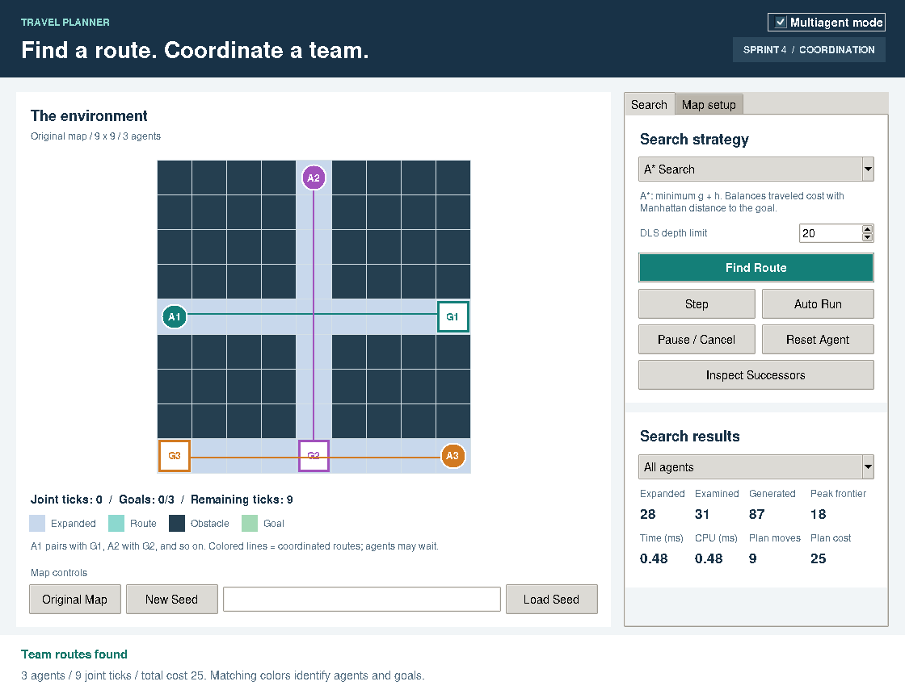
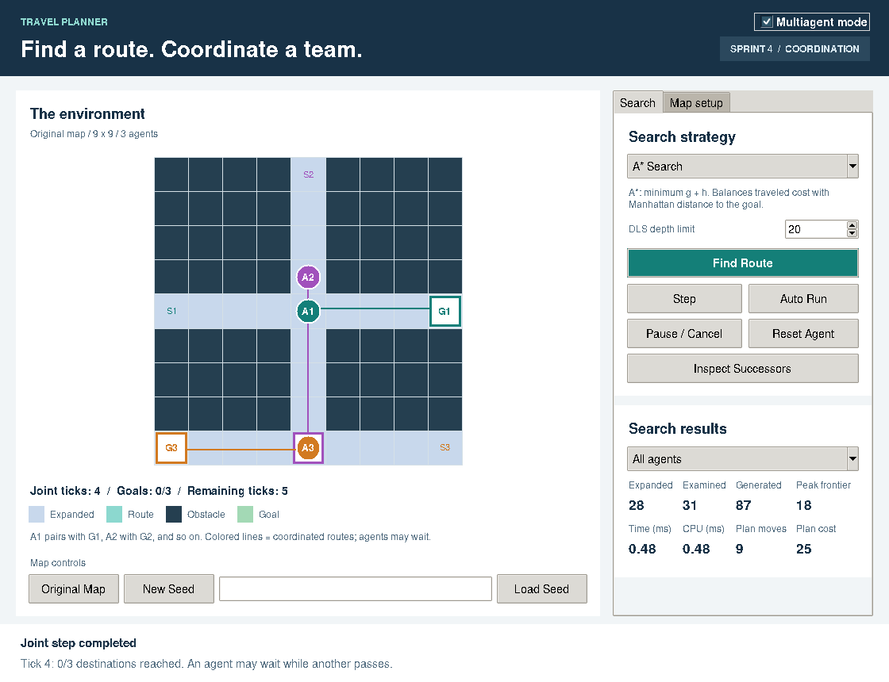
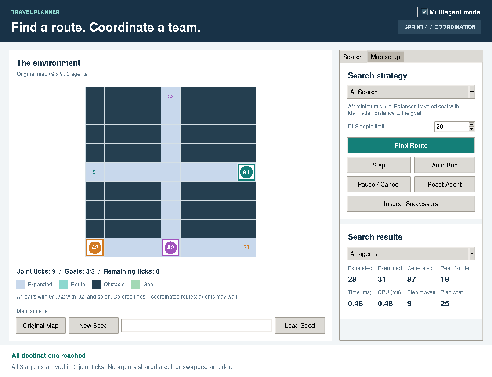
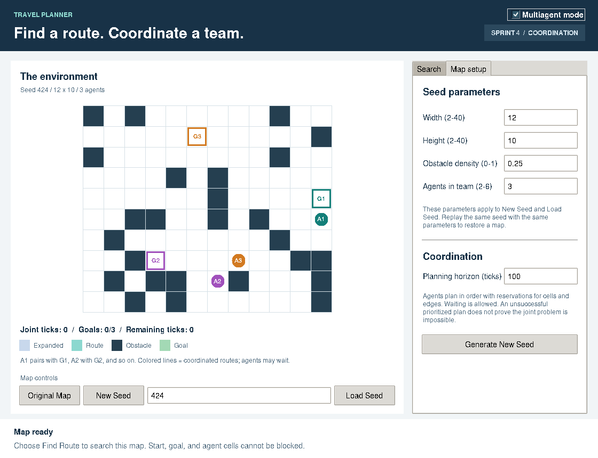
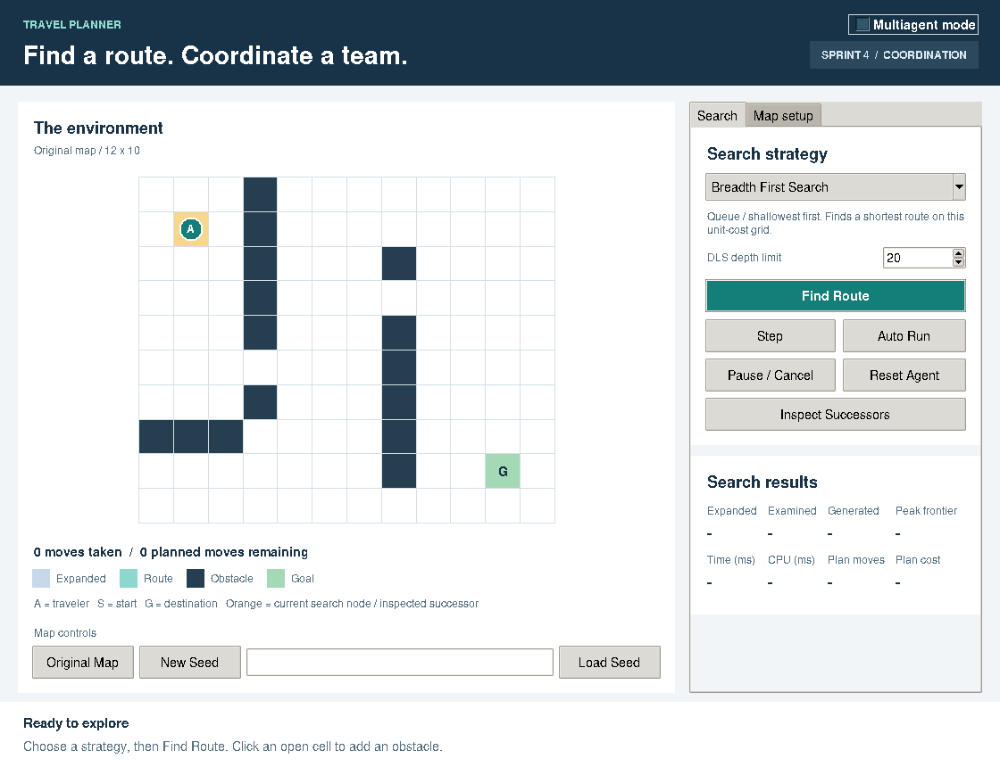

# Sprint 4 sample outputs

These are actual captures from the submitted implementation. Times vary between machines and runs.

| Output | What it demonstrates |
|---|---|
| [Informed comparison](informed_comparison.txt) | A* cost 8 versus greedy cost 10, with BFS/UCS controls and route replay. |
| [Coordinated A*](multiagent_demo.txt) | Three intersecting routes; one wait; all goals reached in nine ticks. |
| [Coordinated greedy](multiagent_greedy_demo.txt) | Greedy planning under the same time/reservation constraints. |
| [Seeded team replay](seeded_multiagent_demo.txt) | Seed 424, 12x10 grid, three agents, density 0.25, horizon 100. |
| [Seed generation](seed_generation_demo.txt) | Generated endpoints, obstacles, identical recreation, and fingerprint. |
| [Test report](test_results.txt) | Full automated run including real desktop-interface tests. |
| [Single-agent travel](travel_demo.txt) | Retained game loop and movement. |
| [Earlier strategies](algorithms_demo.txt) | DFS/BFS/DLS/UCS remain integrated. |
| [Infrastructure](infrastructure_demo.txt) | Node expansion and transition-model prediction. |

## Coordinated routes

## Waiting at a crossing

## All destinations reached

## Reproducible map controls

## Retained single-agent mode

